<div align="center">



<br>


</div>

Question answering over German employment law, with exact paragraph citations.

Ask *"how long is my break entitlement?"* and get an answer sourced to
`§ 4 ArbZG` — not a page number, not a summary.

Currently indexes the **Arbeitszeitgesetz** (working time act). The pipeline
works on any federal law from gesetze-im-internet.de.

> The spinning cloud above is not decoration: it is a PCA of the live 768-dim
> index, one dot per Absatz, coloured by Abschnitt, with each chunk linked to
> its top-1 cosine neighbour. Regenerate it with
> `python .github/assets/make_assets.py`.

---

## Pipeline



| Step | Tool | Output |
|---|---|---|
| 1. Parse | `parse_law.py` | 80 Absatz-level chunks with § metadata |
| 2. Embed | `multilingual-e5-base` | 768-dim vectors |
| 3. Index | Qdrant | searchable collection |
| 4. Retrieve | `ingest.py --ask` | top-k chunks with citations |
| 5. Generate | `gpt-4o-mini` | grounded answer with § references |

---

## Design decisions

**Chunked by Absatz, not by token count**

German law is cited as `§ 3 Abs. 1`. Fixed-size chunks cut across those
boundaries, so a retrieved chunk can't be attributed to one subsection. Absatz
is the smallest citable unit, so it's the natural chunk.

**Multilingual embeddings, not German-only**

Queries arrive in English against German source text. Multilingual models place
a sentence and its translation close together in one vector space; a
German-only model would score higher on German-to-German but can't bridge the
two languages.

**Qdrant**

Overkill at 80 chunks, NumPy would do. Used because it's what scales, and it
gives persistence and metadata filtering for free.

**Grounding over recall**

The retriever always returns k chunks, cosine similarity has no notion of
"nothing matches," so an off-topic question still gets five confident-looking
paragraphs back. Refusal therefore has to happen in the generation step: the
model is instructed to answer only from the provided text and to say so when
that text doesn't cover the question. For legal QA a confident wrong answer
with a plausible citation is worse than no answer.

---

## Results

Retrieval measured on 91 hand-labelled questions with ground-truth § references,
in German and English.



| Config | recall@1 | recall@5 | MRR |
|---|---|---|---|
| Dense (top-5) | 0.44 | 0.84 | 0.585 |
| Dense top-20 + cross-encoder rerank | 0.60 | 0.90 | 0.722 |

**By query language**

| | recall@1 (dense) | recall@1 (reranked) | recall@5 (dense) | recall@5 (reranked) |
|---|---|---|---|---|
| German | 0.59 | 0.59 | 0.83 | 0.89 |
| English | 0.29 | 0.60 | 0.84 | 0.91 |

Reranking doubled English recall@1 and left German unchanged, closing a 30-point
cross-lingual gap to one point. A cross-encoder can only reorder candidates, so
this is direct evidence that the English deficit was a ranking failure rather than
a retrieval failure — the correct paragraph was already being found and ordered
badly.

<details>
<summary><b>Caveat: the two effects are confounded in this run</b></summary>

<br>

recall@5 also rose in both languages. Reordering five results cannot change
whether the answer is among them, so that gain comes from widening the candidate
pool from 5 to 20 before reranking, not from the reranker itself. Separating them
means rerunning the reranker over the top-5 only, which is listed under **Next**.

</details>

---

### Abstention: can retrieval confidence tell answerable from unanswerable?

The retriever always returns k chunks, so an off-topic question still gets five
confident-looking paragraphs back. That raises the question of whether any
retrieval signal indicates when the corpus cannot answer at all.

Measured on 91 answerable and 22 unanswerable questions. AUROC is threshold-free:
1.0 is perfect separation, 0.5 is no information.



| Signal | AUROC | answerable (mean) | unanswerable (mean) |
|---|---|---|---|
| Cosine top-1 | 0.660 | 0.846 | 0.828 |
| Top-1 minus top-2 gap | 0.682 | 0.007 | 0.003 |
| Mean top-5 cosine | 0.644 | 0.836 | 0.821 |
| **Cross-encoder top-1** | **0.828** | **0.594** | **0.159** |

Cosine similarity separates the two populations by 0.018. The cross-encoder
separates them by 0.435, roughly twenty-four times wider. Embedding similarity
measures topical proximity, not whether a passage constitutes sufficient
evidence, so a threshold on cosine score cannot support abstention here. A
relevance model recovers most of that signal.

Cosine separability also differs by language (German AUROC 0.806, English 0.669),
a second cross-lingual asymmetry independent of the ranking gap above.

<details>
<summary><b>Caveat: 22 negatives shows separation, not a threshold</b></summary>

<br>

Twenty-two negatives is enough to show separation exists, not enough to calibrate
a threshold. They are also almost all out-of-corpus questions; the harder case is
in-corpus-but-uncovered, where topically adjacent paragraphs exist.

</details>

---

## Web interface

```bash
pip install -r requirements.txt
uvicorn serve:app --port 8000
```

`serve.py` imports the same `embed_query`, `rerank` and `attributed_answer`
the CLI and the eval harness use, so the UI shows the pipeline that was
measured rather than a second copy that can drift from it. With no Qdrant on
`localhost:6333` it embeds `arbzg.jsonl` into a local on-disk Qdrant under
`qdrant_data/` on first start, so it runs without Docker.

Four endpoints:

| Route | Returns |
|---|---|
| `GET /api/meta` | models, dimensions, index source, corpus counts |
| `GET /api/corpus` | every indexed chunk with its § metadata and 2-D projection |
| `POST /api/query` | one JSON document: candidates, scores, evidence, answer, claims |
| `GET /api/query/stream` | the same pipeline as SSE, one event per finished stage |

Reranking and claim attribution each take tens of seconds on CPU, so the
stream exists to avoid a minute of blank screen: the dense candidates render
as soon as the vector search returns, the evidence when the reranker lands,
the answer and then the per-claim attribution after that. Every stage event
carries the timings measured for that stage; nothing in the interface is a
predicted progress bar.

What the interface shows is what the backend computed:

- **Rerank ladder** — all 20 candidates in bi-encoder order against
  cross-encoder order, with both score ranges drawn on a shared 0–1 axis. The
  cosine scores of a query typically span ~0.05 while the cross-encoder scores
  span ~0.95, which is the finding in the table above made visible per query.
- **Index plane** — the 2-D PCA of the real 768-dim passage vectors, with the
  query projected through the same fitted transform. It retains ~18 % of the
  variance and is labelled as display-only; ranking uses cosine over all 768
  dimensions.
- **Parsing diagram** — the real § structure, one cell per Absatz, cell width
  proportional to its character count.
- **Claim attribution** — each claim with its best-matching Absatz and that
  cross-encoder score, including the ones below threshold.

A contract check for the HTTP layer:

```bash
python test_serve.py          # needs the server already running
```

### Deploy

The two halves have opposite requirements, so they are hosted apart. The
frontend is static files; the backend holds `multilingual-e5-base` and
`bge-reranker-v2-m3` in memory, roughly 3.5 GB of weights, which rules out
every serverless platform.

| Half | Host | Why |
|---|---|---|
| `web/` | Vercel | static, no build step (`vercel.json`) |
| `serve.py` | Hugging Face Space, Docker SDK | free CPU tier has the RAM for both models |

`deploy/space/` is the whole Space: a `Dockerfile` that clones this repo,
derives `arbzg.jsonl` from the official XML, and bakes both models and the
Qdrant index into the image so the first query doesn't pay for them.

```bash
# backend
hf auth login
hf repo create german-law-rag --repo-type space --space_sdk docker
git clone https://huggingface.co/spaces/<user>/german-law-rag space && cd space
cp ../deploy/space/* . && git add -A && git commit -m "backend" && git push

# frontend — after setting <meta name="api-base"> in web/index.html
# to https://<user>-german-law-rag.hf.space
npx vercel && npx vercel --prod
```

Set `OPENAI_API_KEY` as a Space secret for generation, and `CORS_ORIGINS` to
the Vercel origin once it exists. The frontend treats `localhost` as
same-origin regardless of that meta tag, so local development is unaffected.

Reranking 20 candidates takes about a minute on the free CPU tier. The stream
is what makes that bearable: dense candidates render as soon as the vector
search returns.

---

## Setup

**1. Start Qdrant**

```bash
docker run -d --name qdrant -p 6333:6333 -v qdrant_storage:/qdrant/storage qdrant/qdrant
```

**2. Install**

```bash
pip install -r requirements.txt
```

**3. Add your OpenAI key**

Create a `.env` file in the project root:

```
OPENAI_API_KEY=sk-...
```

Used only for answer generation. Retrieval (`--ask`) works without it.

**4. Get the law**

```bash
curl -O https://www.gesetze-im-internet.de/arbzg/xml.zip
unzip xml.zip
python parse_law.py BJNR117100994.xml -o arbzg.jsonl
```

**5. Index and query**

```bash
python ingest.py

# retrieval only — see which paragraphs match
python ingest.py --ask "Wie lange darf ich am Tag arbeiten?"

# full answer, grounded in the retrieved paragraphs
python ingest.py --answer "Wie lange sind meine Ruhepausen?"

# refuses when the retrieved paragraphs don't cover the question
python ingest.py --answer "Wie hoch ist der Mindestlohn?"
```

---

## Status

**Working**
- Absatz-level parsing of official Bundesrecht XML into 80 chunks with § metadata
- Dense retrieval over Qdrant with multilingual embeddings
- Cross-encoder reranking, benchmarked against the dense baseline
- Retrieval evaluation on 91 hand-labelled questions (recall@1, recall@5, MRR,
  split by query language)
- Abstention analysis: four retrieval confidence signals compared by AUROC on
  answerable vs unanswerable questions
- Answer generation grounded in retrieved paragraphs, with refusal when the
  retrieved text doesn't cover the question
- FastAPI service with the models loaded once at startup, and a web interface
  that renders the real per-query scores, rank changes and claim attribution

**In progress**
- Claim-level evidence attribution: answers are decomposed into individual claims
  and each is scored against the retrieved paragraphs, so support is reported per
  sentence rather than per answer. Implemented; awaiting hand-labelled ground
  truth to measure whether the cross-encoder signal holds at claim granularity
  (0.828 at question level)

**Next**
- Claim taxonomy at extraction: meta-statements about the corpus are not
  evidenceable and currently pollute attribution
- Expand the negative set to ~60, stratified into out-of-corpus and
  in-corpus-but-uncovered
- Separate the reranking effect from the wider candidate pool (rerank top-5 only)
- Docker Compose and CI that fails on retrieval regression
- Additional laws (BUrlG, MiLoG) with metadata filtering and a router

---

## Notes

Not legal advice.

Source: [gesetze-im-internet.de](https://www.gesetze-im-internet.de) — German
federal law is public domain under § 5 UrhG.
